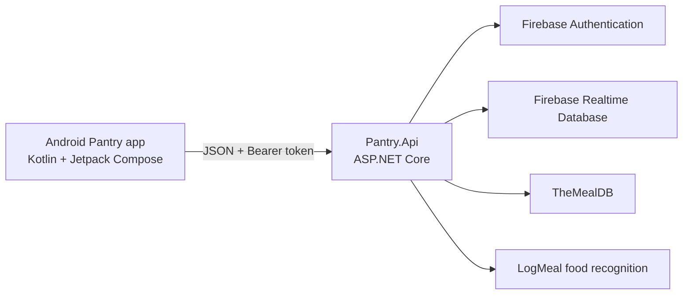

# Pantry — PROG7314 Part 2 prototype

Pantry is an Android recipe app that starts from **what is already in the kitchen**. Users sign in, keep a digital pantry, and receive recipes ranked by how many ingredients they already own.

This repository is the Part 2 prototype for group **EMGPPT**: Sihle Nathi Simelane (`Sihl3s`), Blessing Makhukhula (`blessing-unlimited`), Regopotsoe Lesedi Khutoane (`ST10443296`), and Nomathamsanqa Tame (`NomathamsanqaTame`).

The custom ASP.NET API does the heavy lifting. TheMealDB is only the recipe catalogue; pantry items, settings, shopping lists, and profiles are stored by the API (in-memory on localhost, Firebase Realtime Database when `Firebase:BaseUrl` is set). Camera photos are identified through LogMeal on the API so the key never ships in the APK (TheMealDB, 2026; Firebase, 2026; LogMeal API, 2026).

## Demonstration video

Thami will add an unlisted YouTube link here after the physical-device recording:

## Live Deployment & Demonstration Videos
**Hosted API Base URL:** 'https://pantry-api-8x99.onrender.com/'

Follow Thami's numbered checklist under [Work still to do](#nomathamsanqa-tame-nomathamsanqatame--hosted-api-demo-video-readme-media). Scan and shopping lists are already on `main` and can be filmed.

## Architecture



MVVM on Android keeps screens thin. Retrofit talks only to `/api/v1/*`. Reverse-pantry ranking runs on the API because TheMealDB's free filter accepts **one** ingredient per call (TheMealDB, 2026; Android Developers, 2024).

### Part 2 scope

Included now: SSO session (`POST /api/v1/auth/sso`), settings, pantry CRUD, recipe search/detail, reverse-pantry match, shopping-list generate/CRUD, substitutions, LogMeal photo identify/confirm, CameraX/gallery scan, unit tests, GitHub Actions, comments with citations.

Deferred to the final POE (assignment brief): biometrics, offline Room sync, push notifications, multi-language.

**Lesedi and Thami still have assigned work.** Blessing's remaining work is Google SSO on Android and testing the app. Sihle owns local Realtime Database secrets. Thami hosts the API for the video — see [Work still to do](#work-still-to-do-classmates).

## Sihle Nathi Simelane (`Sihl3s`) — work on `main`

Sihle built the Part 2 vertical slice that the rest of the group extends:

- **Custom REST API** (`api/Pantry.Api`): SSO session (`POST /api/v1/auth/sso`), user settings, pantry CRUD, ingredient search, recipe search/detail, and the reverse-pantry **match** endpoint that ranks TheMealDB meals against the signed-in user's pantry (match %, have/missing counts). Firebase Realtime Database when `Firebase:BaseUrl` is set; in-memory store if that value is empty.
- **Firebase Realtime Database (local):** group project created, test-mode rules published, and `Firebase:BaseUrl` / `Firebase:ProjectId` set with `dotnet user-secrets` on Sihle's machine. The live database URL is not in git. Thami reuses the same values as host environment variables; Blessing uses the same Firebase project for Google SSO.
- **Android client** (`android/`): Kotlin + Jetpack Compose MVVM app with splash, Google Sign-In plus local demo SSO, bottom navigation (Home, Pantry, Recipes, Profile), pantry add/remove, ranked recipe cards, recipe detail, and settings saved through the API.
- **Part 1 brand:** terracotta / basil / cream theme, Playfair Display + Source Sans 3, plate-and-steam logo, branded splash and sign-in header, circular recipe thumbs, readiness lines, and terracotta-pill bottom nav.
- **Quality / DevOps:** xUnit matching and shopping-list tests, JUnit helpers on Android, GitHub Actions (`api-ci` and `android-ci`; Android SDK setup uses current `platform-tools`), README run steps, and the classmate owner checklists so Blessing, Lesedi, and Thami can commit from their own accounts.
- **Help on Blessing's slice:** merge-conflict cleanup on his shopping-list / LogMeal commits, CameraX + gallery scan UI against `POST /api/v1/food-recognition`, shopping-list screen, and wiring shopping generate to recipe detail. Google SSO client files remain Blessing's; public hosting remains Thami's.

## Blessing Makhukhula (`blessing-unlimited`) — work on `main`

Blessing added the Part 1 custom features that sit on top of Sihle's SSO / pantry / match slice:

- **Shopping lists:** `POST /api/v1/shopping-lists/generate` from recipe ids, list/get/patch/delete, de-duplicated missing ingredients tagged with source recipe titles (`ShoppingListGenerator`).
- **Substitutions:** `GET /api/v1/substitutions/{ingredientId}` with pantry-aware alternatives.
- **Food recognition:** LogMeal image segmentation (`LogMealService`, `POST /api/v1/food-recognition/identify` and `/confirm`) so a photo can suggest ingredient names. Set `LogMeal:ApiToken` with user secrets — never commit the key.

## How to run the API (localhost)

Requires the [.NET 10 SDK](https://dotnet.microsoft.com/download).

```bash
dotnet restore api/Pantry.slnx
dotnet test api/Pantry.slnx
dotnet run --project api/Pantry.Api --launch-profile http
```

- API: http://localhost:5080
- Swagger: http://localhost:5080/swagger

In Swagger click **Authorize** and enter `dev-token` (Development only). Then:

1. `POST /api/v1/auth/sso` with `{ "idToken": "dev-token", "displayName": "Sihle" }`
2. `POST /api/v1/pantry-items` with `{ "ingredientName": "chicken" }`
3. `POST /api/v1/recipes/match` — ranked TheMealDB recipes with missing-ingredient counts
4. `POST /api/v1/shopping-lists/generate` with `{ "recipeIds": ["52772"] }` after matching a recipe
5. Optional: set `LogMeal:ApiToken`, then `POST /api/v1/food-recognition/identify` with an image file

Sample requests: [api/Pantry.Api/Pantry.Api.http](api/Pantry.Api/Pantry.Api.http).

For photo recognition on localhost:

```bash
dotnet user-secrets set "LogMeal:ApiToken" "YOUR_TOKEN" --project api/Pantry.Api
```

### Persist to Firebase

Sihle has already initialised user secrets on `api/Pantry.Api` (`UserSecretsId` in the `.csproj`). The live BaseUrl stays in that secret store (or Thami's host environment variables), never in git.

```bash
dotnet user-secrets set "Firebase:BaseUrl" "https://YOUR-PROJECT-default-rtdb.REGION.firebasedatabase.app/" --project api/Pantry.Api
dotnet user-secrets set "Firebase:ProjectId" "YOUR-PROJECT" --project api/Pantry.Api
```

Realtime Database must stay in **test mode** for the prototype because the API calls the REST URL without a database secret (OWASP, 2023). After secrets are set, Swagger **Authorize** with `dev-token` and `POST /api/v1/pantry-items` should show `users/dev-user-sihle/pantryItems` in the Firebase Data tab. Never commit `*firebase-adminsdk*.json` or the live BaseUrl.

## How to run the Android app

1. Open the `android/` folder in Android Studio (Ladybug / 2024.2 or newer).
2. Let Gradle sync. JDK 17 is required.
3. Start the API on port 5080 first.
4. Run on an **emulator**. Debug builds call `http://10.0.2.2:5080/` (the host loopback alias) (Android Developers, 2024).
5. Tap **Continue with Google**. If `default_web_client_id` is still the placeholder, use **Continue (local demo SSO)** so the prototype can be shown before Firebase is wired.
6. Demo path: add pantry items (or **Scan with camera** / gallery) → Home ranked recipes → open a recipe → **Add missing** → **Shopping lists**.
7. Physical phone: put your PC and phone on the same Wi-Fi, allow port 5080 through the firewall, and change `API_BASE_URL` in [android/app/build.gradle.kts](android/app/build.gradle.kts) to `http://YOUR_LAN_IP:5080/`.

Copy [android/app/google-services.json.example](android/app/google-services.json.example) to `android/app/google-services.json` when the Firebase Android app is registered. The Google Services Gradle plugin applies automatically once that file exists.

## Work still to do (classmates)

Commit from **your own GitHub account** so GitHub lists you as a contributor. Do not use Sihle's account. Clone this repo, create a branch named after yourself, push, and open a pull request into `main`.

Shared setup before anyone codes:

1. Clone https://github.com/EMGPPT/prog7314-2026-prog7314-2026-part2-blessing-unlimited
2. Run the API with `dotnet run --project api/Pantry.Api --launch-profile http`
3. Open `android/` in Android Studio and confirm the app still compiles
4. Read the files named in your section so you extend them instead of rewriting Sihle's working SSO / pantry / match flow
5. Add comments and Harvard-style citations (sources from 2016 onward) on any new code
6. Push often so GitHub Actions runs on your commits

---

### Blessing Makhukhula (`blessing-unlimited`) — Google SSO and Android testing

Shopping lists, substitutions, LogMeal identify/confirm, CameraX/gallery scan, and the shopping-list screen are already on `main`. Realtime Database local wiring is Sihle's. **Hosting is Thami's.** Blessing's remaining work:

1. Pull `main`, run the API + emulator, and test: demo SSO, pantry add, scan/gallery, recipe match, Add missing → shopping list.
2. Enable **Authentication → Google** on the group Firebase project. Register Android package `za.ac.vc.emgppt.pantry`.
3. Put `google-services.json` in `android/app/` (do not commit secrets beyond the school project's client file if the lecturer expects it).
4. Put the Web client ID in `android/app/src/main/res/values/strings.xml` (`default_web_client_id`) so **Continue with Google** returns a real ID token.
5. Set LogMeal locally if you need scan: `dotnet user-secrets set "LogMeal:ApiToken" "YOUR_TOKEN" --project api/Pantry.Api`.

---

### Lesedi Khutoane (`ST10443296`) — cook mode, onboarding, profile gamification

**Goal:** Finish the Part 1 custom UX: hands-free cooking, first-login dietary setup, and kitchen-journey badges. Do not break navigation that already works.

1. Open [CookModeScreen](android/app/src/main/java/za/ac/vc/emgppt/pantry/ui/group/GroupScreens.kt). Keep the dark theme and step pager; this is only a scaffold today.
2. Keep the screen awake while cook mode is open (`FLAG_KEEP_SCREEN_ON` or `KeepScreenOn` in Compose) (Android Developers, 2024).
3. Show **one instruction at a time**, large enough to read at arm's length, with "Step X of Y".
4. Add swipe and Previous / Next controls that are easy to hit with a thumb.
5. Add a per-step countdown timer (start / pause) for steps that mention a time; a simple `mm:ss` timer is enough.
6. Show ingredient chips for the **current step only** when you can parse them; otherwise show the recipe's pantry have/missing row.
7. Add a first-login **onboarding** screen after SSO (dietary chips, allergen text, cuisine pills, Continue / Skip) matching Part 1. Save with `PATCH /api/v1/users/me/settings`. Skip if settings already exist.
8. On [SettingsScreen.kt](android/app/src/main/java/za/ac/vc/emgppt/pantry/ui/settings/SettingsScreen.kt), replace the "gamification assigned to Lesedi" note with a real profile block: avatar initials, level title (for example Home Chef), XP bar, streak days, and badges such as "No Waste Week" and "7-Day Streak".
9. Award XP / streak when the user finishes cook mode (call the API if you add a small endpoint, or persist locally for Part 2 and document that the API should own it later).
10. Polish filter pills and recipe cards against the Part 1 terracotta / basil mockups if time remains.
11. Run the app: Sign in → optional onboarding → open a recipe → **Start cooking** → confirm wake-lock, swipe, and timer. Commit from `ST10443296`.

---

### Nomathamsanqa Tame (`NomathamsanqaTame`) — hosted API, demo video, README media

**Goal:** Host the API on the public internet, then record the Part 2 submission video. Rehearse on localhost first if hosting is not ready.

1. Host the API (Azure for Students, Render, Cloud Run, or similar). Set environment variables `Firebase__BaseUrl` and `Firebase__ProjectId` to the same values Sihle uses locally (ask Sihle in the group chat — do not put them in git).
2. Put the public HTTPS URL into `API_BASE_URL` in [android/app/build.gradle.kts](android/app/build.gradle.kts) for the physical-device build.
3. Install the debug APK on a physical Android phone. Point the app at the hosted API (or the PC LAN IP if hosting is not ready).
4. Record with any screen recorder. Speak throughout. Keep the video unlisted on YouTube (or another link the lecturer can open).
5. **Authentication:** show a new user registering / signing in with Google SSO. If Google is not wired yet, say so on camera and show the working SSO session against the API, then record Google again once Blessing adds `google-services.json`.
6. **Settings:** open Profile, change dietary preferences or max missing ingredients, tap Save, then reopen the screen (or Swagger `GET /api/v1/users/me/settings`) to prove it persisted.
7. **Web services:** add pantry items, open Home/Recipes, and show ranked matches from the custom API (not TheMealDB in a browser). Open a recipe detail so missing vs in-pantry is visible.
8. **Data verification:** on camera, show three places for the same user: Firebase Authentication (user list), Swagger of the hosted API (pantry/match JSON), and Firebase Realtime Database (prefer real DB records under `users/`).
9. **Custom feature:** demonstrate reverse-pantry matching (match % and missing ingredients). Also film **Scan with camera** (or gallery) adding a pantry item, and **Add missing** → shopping list checkboxes. Film Lesedi's cook mode if that is merged by recording day.
10. Polish the app icon / splash if you want a visible commit (adaptive icon files under `android/app/src/main/res/`).
11. Capture screenshots of splash, sign-in, home, pantry, recipe match, settings, and (if ready) cook mode / shopping list.
12. Embed the unlisted YouTube link at the top of this README where it currently says `_pending — Nomathamsanqa Tame_`. Add the screenshots under a short "Screenshots" heading.
13. Commit and push from `NomathamsanqaTame` so you appear on the contributor graph.

---

## Version control and GitHub Actions

Work is committed incrementally on this repository (not ZIP uploads). Two workflows run on every push:

| Workflow | File | What it does |
| --- | --- | --- |
| API CI | [.github/workflows/api-ci.yml](.github/workflows/api-ci.yml) | `dotnet test` for reverse-pantry and shopping-list unit tests |
| Android CI | [.github/workflows/android-ci.yml](.github/workflows/android-ci.yml) | JDK 17, current Android SDK `platform-tools`, Gradle `testDebugUnitTest`, `assembleDebug` |

## Project layout

```
api/Pantry.Api/             Custom REST API (match, pantry, shopping lists, LogMeal)
api/Pantry.Api.Tests/       xUnit tests (no network)
android/app/src/main/       Kotlin + Jetpack Compose client
.github/workflows/          GitHub Actions
CONTRIBUTING.md             Short owner table (detailed steps are in this README)
```

## References

Android Developers (2024) *Build a UI with Jetpack Compose*. Available at: https://developer.android.com/compose (Accessed: 17 September 2026).

Android Developers (2024) *Retrofit and networking on Android*. Available at: https://developer.android.com/guide/topics/connectivity (Accessed: 17 September 2026).

Fielding, R., Nottingham, M. and Reschke, J. (2022) *RFC 9110: HTTP Semantics*. RFC Editor. Available at: https://www.rfc-editor.org/rfc/rfc9110.html (Accessed: 17 September 2026).

Firebase (2026) *Firebase Authentication* and *Realtime Database REST API*. Available at: https://firebase.google.com/docs (Accessed: 17 September 2026).

LogMeal API (2026) *Image segmentation complete*. Available at: https://docs.logmeal.com/reference/post_v2-image-segmentation-complete (Accessed: 20 September 2026).

OWASP (2023) *OWASP API Security Top 10 – 2023*. Available at: https://owasp.org/API-Security/editions/2023/en/0x11-t10/ (Accessed: 17 September 2026).

TheMealDB (2026) *API documentation*. Available at: https://www.themealdb.com/api.php (Accessed: 17 September 2026).
