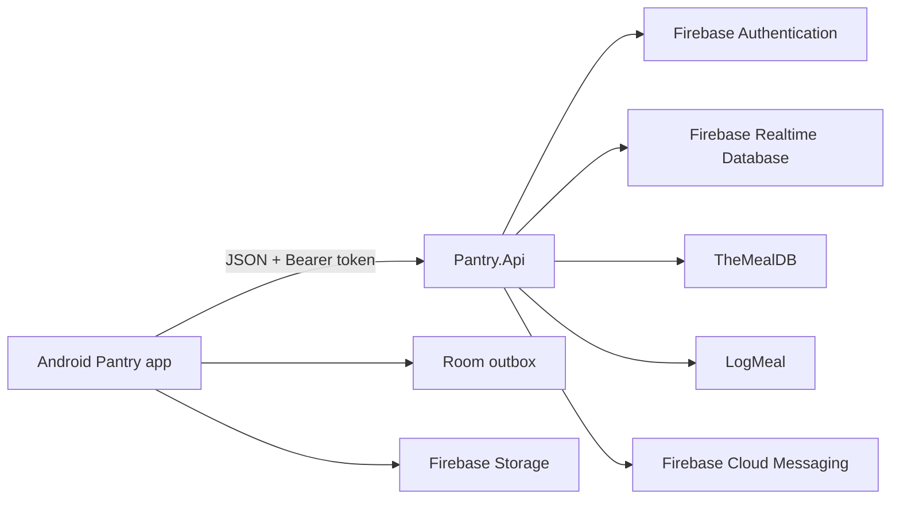

# Pantry — PROG7314 Final POE

**Module:** PROG7314  
**Assessment:** Summative 1, final Portfolio of Evidence  
**Group:** EMGPPT  
**Release:** 1.0.0 (`Final-POE`)  
**Repository:** [EMGPPT/prog7314-2026-prog7314-2026-part2-blessing-unlimited](https://github.com/EMGPPT/prog7314-2026-prog7314-2026-part2-blessing-unlimited)

| Member | Student GitHub |
| --- | --- |
| Sihle Nathi Simelane | [`Sihl3s`](https://github.com/Sihl3s) |
| Blessing Makhukhula | [`blessing-unlimited`](https://github.com/blessing-unlimited) |
| Regopotsoe Lesedi Khutoane | [`ST10443296`](https://github.com/ST10443296) |
| Nomathamsanqa Tame | [`NomathamsanqaTame`](https://github.com/NomathamsanqaTame) |

Pantry is an Android recipe application that starts from what is already in the kitchen. A signed-in user keeps a digital pantry and receives recipes ranked by how many ingredients they already own. Ranking, pantry persistence, shopping lists, and food recognition run on a custom hosted REST API. TheMealDB is used only as the recipe catalogue (TheMealDB, 2026).

## Purpose and design

The client is a Kotlin and Jetpack Compose app. It talks only to `/api/v1/*` on the custom ASP.NET Core API, so recipe ranking stays on the server. TheMealDB’s free filter accepts one ingredient per request, which is why the match is computed in `Pantry.Api` (TheMealDB, 2026; Android Developers, 2024). Records are stored per authenticated user (OWASP, 2023).

The final build adds the POE capabilities that the prototype deferred: biometric unlock, an offline Room cache with an outbox, blob storage for scan photos, Cloud Messaging, and English, isiZulu, and Afrikaans.



## Demonstration videos

| Recording | Link |
| --- | --- |
| Part 2 mobile application demonstration | https://youtu.be/74z5YRa-JMU |
| Part 2 API, Swagger and code walkthrough | https://youtu.be/XWsTvCrPVqk |
| Final POE on a physical phone | Replace this cell with the unlisted YouTube URL after the voice-over recording. |

The final video must show Google sign-in together with biometric unlock, a settings change, a live call to this API, an offline pantry or shopping action that syncs after reconnect, and the same change in Firebase and the API. It also has to walk through the features defined in Part 1.

## Hosted API

| Resource | URL |
| --- | --- |
| Live API | https://pantry-api-8x99.onrender.com/ |
| Swagger | https://pantry-api-8x99.onrender.com/swagger/index.html |
| Health | https://pantry-api-8x99.onrender.com/api/v1/health |

The API image is [Dockerfile](Dockerfile), deployed on Render. Release and debug builds of the app call this HTTPS host. A debug build can point at a machine on the LAN by setting `pantry.apiBaseUrl` in `android/local.properties`. Cleartext is allowed only for `localhost`, `127.0.0.1`, and `10.0.2.2` in debug (Android Developers, 2024).

Pantry rows, settings, shopping lists, and profiles are read and written in **Firebase Realtime Database**. Google identity is **Firebase Authentication**. Scan photos are objects in **Firebase Storage** (`firebase/storage.rules`); the download URL is saved on the pantry item through the API, so the NoSQL record and the blob stay linked (Firebase, 2026). Camera recognition still uses LogMeal on the server so that key is not in the APK (LogMeal API, 2026).

## Features

**Authentication.** Google sign-in, then `POST /api/v1/auth/sso`. After the first successful sign-in the app can enrol `BiometricPrompt`. A later cold start stays on the lock screen until fingerprint or face succeeds, or until the user cancels and tries again. The app never stores a biometric sample (Android Developers, 2025). Debug builds may still use the development SSO token. Release builds do not.

**Offline pantry and shopping.** Adds, deletes, and shopping-list ticks are written to Room immediately and to a pending-operation table. `SyncQueue` keeps the latest write per entity. When a network returns, the outbox is replayed to the API and the screen reloads. The last recipe match list is cached for offline reading. Recipe search itself still needs the network (Android Developers, 2024).

**Languages.** Settings stores `languageCode` as `en`, `zu`, or `af`. The app applies that choice with the per-app locale API (Android Developers, 2026). English, isiZulu, and Afrikaans cover the navigation, sign-in, pantry, scan, and settings copy.

**Notifications.** The app registers an FCM device token with `PUT /api/v1/users/me/device`. `POST /api/v1/notifications/test`, and a successful pantry add when notifications are enabled, send through Firebase Cloud Messaging HTTP v1 if the host has `Firebase:ServiceAccountJson` or `Firebase:ServiceAccountPath`. Those values are environment configuration. They are not in git. Without them the test endpoint returns a clear 503 and the app shows that message instead of crashing (Firebase, 2026).

**Already in the prototype.** Onboarding, dietary settings, reverse-pantry match, recipe detail, cook mode, CameraX and gallery scan, shopping-list generation, and substitutions.

## Play Store preparation

| Artefact | Location |
| --- | --- |
| Version | `1.0.0` (version code 2), application id `za.ac.vc.emgppt.pantry` |
| Signed release APK | [releases/pantry-1.0.0-release.apk](releases/pantry-1.0.0-release.apk) |
| Listing copy and store icon | [docs/play-store/listing.md](docs/play-store/listing.md) |
| Launcher icon | Adaptive icon `ic_launcher`, terracotta plate mark |

The upload keystore and `android/keystore.properties` stay on the machine that signs the build. They are gitignored. To sign again, create `android/keystore.properties` with `storeFile`, `storePassword`, `keyAlias`, and `keyPassword`, then run `./gradlew assembleRelease` inside `android/`. Release signing follows the Play app-signing guide (Google Play, 2026).

The marker's evidence for publication readiness is this signed APK together with the promotional screenshots. A paid Play Console account is not part of the submitted evidence.

## DevOps

GitHub Actions builds the API and runs xUnit on every push ([.github/workflows/api-ci.yml](.github/workflows/api-ci.yml)). The Android workflow runs unit tests and assembles a debug APK ([.github/workflows/android-ci.yml](.github/workflows/android-ci.yml)). The Android tests cover recipe matching and the offline outbox rules, so CI does not need a phone or Firebase secrets.

The final submission commit is the annotated tag `Final-POE`.

## API surface added for this release

| Method | Path | Purpose |
| --- | --- | --- |
| PUT | `/api/v1/users/me/device` | Store the FCM device token on the user profile |
| POST | `/api/v1/notifications/test` | Send one test alert to that token |
| POST / PATCH | `/api/v1/pantry-items` | Optional `imageUrl` for the Storage object |

The Part 2 routes (SSO, settings, pantry, recipes, match, shopping lists, substitutions, food recognition) are unchanged. See Swagger for the full list.

## Logging

`PantryApplication`, `MainActivity`, sign-in, biometric results, Room queue replay, blob upload, locale changes, and FCM receipt write to the `Pantry` log tag with `android.util.Log`. The API uses `ILogger` for pantry writes, settings updates, and notification attempts.

## Repository layout

```
api/Pantry.Api/             Custom REST API
api/Pantry.Api.Tests/       xUnit tests
android/app/src/main/       Kotlin client (the module Android Studio opens)
firebase/storage.rules      Storage rules for scan blobs
docs/play-store/            Listing copy and store icon
docs/AI_USAGE.md            How generative AI was used
releases/                   Signed production APK
RELEASE_NOTES.md            Changes since the prototype
.github/workflows/          API and Android CI
```

Secrets (`Firebase:BaseUrl`, `Firebase:ServiceAccountJson`, `LogMeal:ApiToken`, `google-services.json`, the upload keystore) are not stored in git.

## Group contributions

| Member | Contribution |
| --- | --- |
| **Sihle Nathi Simelane** (`Sihl3s`) | Part 2 API and Android shell, and for this POE: biometric unlock, Room offline sync, Firebase Storage blobs, English / isiZulu / Afrikaans resources, FCM client and HTTP v1 send path, release signing, this report |
| **Blessing Makhukhula** (`blessing-unlimited`) | Shopping lists, substitutions, LogMeal, Google Sign-In configuration, and authenticated Firebase Realtime Database access for the hosted API |
| **Regopotsoe Lesedi Khutoane** (`ST10443296`) | Cook mode, onboarding, profile XP, badges, and streak |
| **Nomathamsanqa Tame** (`NomathamsanqaTame`) | Dockerfile, Render hosting, Swagger, Part 2 videos, and the final physical-device video |

## Screenshots

Phone captures from the Part 2 device run. Play listing assets are in [docs/play-store](docs/play-store).


## Release notes

Functional changes since the Part 2 prototype are in [RELEASE_NOTES.md](RELEASE_NOTES.md). A short account of generative AI use is in [docs/AI_USAGE.md](docs/AI_USAGE.md).

## References

Android Developers (2024) *Build a UI with Jetpack Compose*. Available at: https://developer.android.com/compose (Accessed: 4 November 2026).

Android Developers (2024) *Connect to the network*. Available at: https://developer.android.com/training/basics/network-ops/connecting (Accessed: 4 November 2026).

Android Developers (2024) *Save data in a local database using Room*. Available at: https://developer.android.com/training/data-storage/room (Accessed: 4 November 2026).

Android Developers (2025) *Show a biometric authentication dialog*. Available at: https://developer.android.com/identity/sign-in/biometric-auth (Accessed: 4 November 2026).

Android Developers (2026) *Per-app language preferences*. Available at: https://developer.android.com/guide/topics/resources/app-languages (Accessed: 4 November 2026).

Fielding, R., Nottingham, M. and Reschke, J. (2022) *RFC 9110: HTTP Semantics*. RFC Editor. Available at: https://www.rfc-editor.org/rfc/rfc9110.html (Accessed: 4 November 2026).

Firebase (2026) *Firebase Authentication*, *Realtime Database*, *Cloud Storage*, and *Firebase Cloud Messaging*. Available at: https://firebase.google.com/docs (Accessed: 4 November 2026).

Google Play (2026) *Sign your app*. Available at: https://developer.android.com/studio/publish/app-signing (Accessed: 4 November 2026).

LogMeal API (2026) *Image segmentation complete*. Available at: https://docs.logmeal.com/reference/post_v2-image-segmentation-complete (Accessed: 4 November 2026).

OWASP (2023) *OWASP API Security Top 10 – 2023*. Available at: https://owasp.org/API-Security/editions/2023/en/0x11-t10/ (Accessed: 4 November 2026).

TheMealDB (2026) *API documentation*. Available at: https://www.themealdb.com/api.php (Accessed: 4 November 2026).

