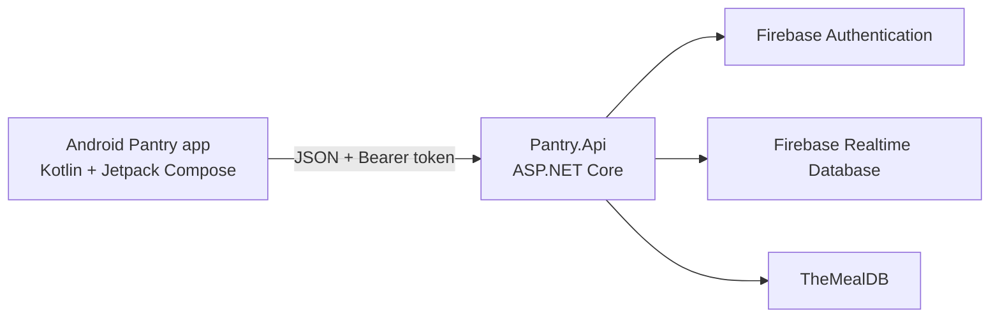

# Pantry — PROG7314 Part 2 prototype

Pantry is an Android recipe app that starts from **what is already in the kitchen**. Users sign in, keep a digital pantry, and receive recipes ranked by how many ingredients they already own.

This repository is the Part 2 prototype for group **EMGPPT**: Sihle Nathi Simelane (`Sihl3s`), Blessing Makhukhula (`blessing-unlimited`), Regopotsoe Lesedi Khutoane (`ST10443296`), and Nomathamsanqa Tame (`NomathamsanqaTame`).

The custom ASP.NET API does the heavy lifting. TheMealDB is only the recipe catalogue; pantry items, settings, and profiles are stored by the API (in-memory on localhost, Firebase Realtime Database when `Firebase:BaseUrl` is set) (TheMealDB, 2026; Firebase, 2026).

## Demonstration video

Thami will add an unlisted YouTube link here after the physical-device recording:

> **Video:** _pending — Nomathamsanqa Tame_

The voice-over must show: Google (or configured) SSO, saving settings, a pantry add plus recipe match round-trip, Firebase Console / Swagger / database records, and reverse-pantry matching.

## Architecture



MVVM on Android keeps screens thin. Retrofit talks only to `/api/v1/*`. Reverse-pantry ranking runs on the API because TheMealDB's free filter accepts **one** ingredient per call (TheMealDB, 2026; Android Developers, 2024).

### Part 2 scope

Included now: SSO session (`POST /api/v1/auth/sso`), settings, pantry CRUD, recipe search/detail, reverse-pantry match, unit tests, GitHub Actions, comments with citations.

Deferred to the final POE (assignment brief): biometrics, offline Room sync, push notifications, multi-language.

Left for group members (see [CONTRIBUTING.md](CONTRIBUTING.md)): shopping lists, substitutions, CameraX scan, cook-mode polish, gamification, hosted API URL, demo video.

## How to run the API (localhost)

Requires the [.NET 10 SDK](https://dotnet.microsoft.com/download).

```bash
dotnet restore api/Pantry.slnx
dotnet test api/Pantry.slnx
dotnet run --project api/Pantry.Api --launch-profile http
```

- API: http://localhost:5080
- Swagger: http://localhost:5080/swagger

In Swagger click **Authorize** and enter `dev-token` (Development only). Then:

1. `POST /api/v1/auth/sso` with `{ "idToken": "dev-token", "displayName": "Sihle" }`
2. `POST /api/v1/pantry-items` with `{ "ingredientName": "chicken" }`
3. `POST /api/v1/recipes/match` — ranked TheMealDB recipes with missing-ingredient counts

Sample requests: [api/Pantry.Api/Pantry.Api.http](api/Pantry.Api/Pantry.Api.http).

### Persist to Firebase

Set in `api/Pantry.Api/appsettings.Development.json` or user secrets:

```json
"Firebase": {
  "BaseUrl": "https://YOUR-PROJECT-default-rtdb.REGION.firebasedatabase.app/",
  "ProjectId": "YOUR-PROJECT"
}
```

Use test-mode rules for the prototype, then lock them down (OWASP, 2023). Never commit `*firebase-adminsdk*.json`.

## How to run the Android app

1. Open the `android/` folder in Android Studio (Ladybug / 2024.2 or newer).
2. Let Gradle sync. JDK 17 is required.
3. Start the API on port 5080 first.
4. Run on an **emulator**. Debug builds call `http://10.0.2.2:5080/` (the host loopback alias) (Android Developers, 2024).
5. Tap **Continue with Google**. If `default_web_client_id` is still the placeholder, use **Continue (local demo SSO)** so the prototype can be shown before Firebase is wired.
6. Physical phone: put your PC and phone on the same Wi-Fi, allow port 5080 through the firewall, and change `API_BASE_URL` in [android/app/build.gradle.kts](android/app/build.gradle.kts) to `http://YOUR_LAN_IP:5080/`.

Copy [android/app/google-services.json.example](android/app/google-services.json.example) to `android/app/google-services.json` when the Firebase Android app is registered. The Google Services Gradle plugin applies automatically once that file exists.

## Version control and GitHub Actions

Work is committed incrementally on this repository (not ZIP uploads). Two workflows run on every push:

| Workflow | File | What it does |
| --- | --- | --- |
| API CI | [.github/workflows/api-ci.yml](.github/workflows/api-ci.yml) | `dotnet test` for reverse-pantry unit tests |
| Android CI | [.github/workflows/android-ci.yml](.github/workflows/android-ci.yml) | JDK 17, Gradle `testDebugUnitTest`, `assembleDebug` |

## Project layout

```
api/Pantry.Api/             Custom REST API (controllers, matching, Firebase store)
api/Pantry.Api.Tests/       xUnit tests (no network)
android/app/src/main/       Kotlin + Jetpack Compose client
.github/workflows/          GitHub Actions
CONTRIBUTING.md             Who implements the remaining features
```

## References

Android Developers (2024) *Build a UI with Jetpack Compose*. Available at: https://developer.android.com/compose (Accessed: 17 September 2026).

Android Developers (2024) *Retrofit and networking on Android*. Available at: https://developer.android.com/guide/topics/connectivity (Accessed: 17 September 2026).

Fielding, R., Nottingham, M. and Reschke, J. (2022) *RFC 9110: HTTP Semantics*. RFC Editor. Available at: https://www.rfc-editor.org/rfc/rfc9110.html (Accessed: 17 September 2026).

Firebase (2026) *Firebase Authentication* and *Realtime Database REST API*. Available at: https://firebase.google.com/docs (Accessed: 17 September 2026).

OWASP (2023) *OWASP API Security Top 10 – 2023*. Available at: https://owasp.org/API-Security/editions/2023/en/0x11-t10/ (Accessed: 17 September 2026).

TheMealDB (2026) *API documentation*. Available at: https://www.themealdb.com/api.php (Accessed: 17 September 2026).
