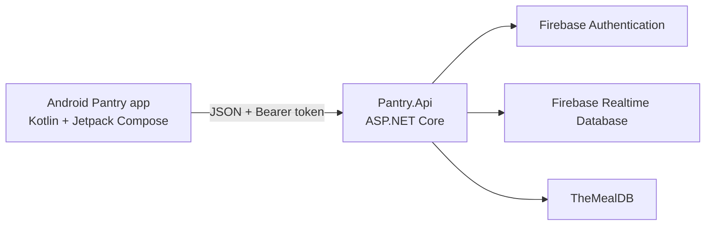

# Pantry — PROG7314 Part 2 prototype

Pantry is an Android recipe app that starts from **what is already in the kitchen**. Users sign in, keep a digital pantry, and receive recipes ranked by how many ingredients they already own.

This repository is the Part 2 prototype for group **EMGPPT**: Sihle Nathi Simelane (`Sihl3s`), Blessing Makhukhula (`blessing-unlimited`), Regopotsoe Lesedi Khutoane (`ST10443296`), and Nomathamsanqa Tame (`NomathamsanqaTame`).

The custom ASP.NET API does the heavy lifting. TheMealDB is only the recipe catalogue; pantry items, settings, and profiles are stored by the API (in-memory on localhost, Firebase Realtime Database when `Firebase:BaseUrl` is set) (TheMealDB, 2026; Firebase, 2026).

## Demonstration video

Thami will add an unlisted YouTube link here after the physical-device recording:

> **Video:** _pending — Nomathamsanqa Tame_

Follow Thami's numbered checklist under [Work still to do](#nomathamsanqa-tame-nomathamsanqatame--demo-video-readme-media-icon-polish).

## Architecture



MVVM on Android keeps screens thin. Retrofit talks only to `/api/v1/*`. Reverse-pantry ranking runs on the API because TheMealDB's free filter accepts **one** ingredient per call (TheMealDB, 2026; Android Developers, 2024).

### Part 2 scope

Included now: SSO session (`POST /api/v1/auth/sso`), settings, pantry CRUD, recipe search/detail, reverse-pantry match, unit tests, GitHub Actions, comments with citations.

Deferred to the final POE (assignment brief): biometrics, offline Room sync, push notifications, multi-language.

**Blessing, Lesedi, and Thami still have assigned work** — follow the step-by-step checklists in [Work still to do](#work-still-to-do-classmates).

## Sihle Nathi Simelane (`Sihl3s`) — work on `main`

Sihle built the Part 2 vertical slice that the rest of the group extends:

- **Custom REST API** (`api/Pantry.Api`): SSO session (`POST /api/v1/auth/sso`), user settings, pantry CRUD, ingredient search, recipe search/detail, and the reverse-pantry **match** endpoint that ranks TheMealDB meals against the signed-in user's pantry (match %, have/missing counts). Firebase Realtime Database store when `Firebase:BaseUrl` is set; in-memory store for localhost.
- **Android client** (`android/`): Kotlin + Jetpack Compose MVVM app with splash, Google Sign-In plus local demo SSO, bottom navigation (Home, Pantry, Recipes, Profile), pantry add/remove, ranked recipe cards, recipe detail, and settings saved through the API.
- **Part 1 brand:** terracotta / basil / cream theme, Playfair Display + Source Sans 3, plate-and-steam logo, branded splash and sign-in header, circular recipe thumbs, readiness lines, and terracotta-pill bottom nav.
- **Quality / DevOps:** xUnit matching tests, JUnit helpers on Android, GitHub Actions (`api-ci` and `android-ci`), README run steps, and the classmate owner checklists so Blessing, Lesedi, and Thami can commit from their own accounts.

## How to run the API (localhost)

Requires the [.NET 10 SDK](https://dotnet.microsoft.com/download).

```bash
dotnet restore api/Pantry.slnx
dotnet test api/Pantry.slnx
dotnet run --project api/Pantry.Api --launch-profile http
```

- API: http://localhost:5080
- Swagger: http://localhost:5080/swagger

In Swagger click **Authorize** and enter `dev-token` (Development only). Then:

1. `POST /api/v1/auth/sso` with `{ "idToken": "dev-token", "displayName": "Sihle" }`
2. `POST /api/v1/pantry-items` with `{ "ingredientName": "chicken" }`
3. `POST /api/v1/recipes/match` — ranked TheMealDB recipes with missing-ingredient counts

Sample requests: [api/Pantry.Api/Pantry.Api.http](api/Pantry.Api/Pantry.Api.http).

### Persist to Firebase

Set in `api/Pantry.Api/appsettings.Development.json` or user secrets:

```json
"Firebase": {
  "BaseUrl": "https://YOUR-PROJECT-default-rtdb.REGION.firebasedatabase.app/",
  "ProjectId": "YOUR-PROJECT"
}
```

Use test-mode rules for the prototype, then lock them down (OWASP, 2023). Never commit `*firebase-adminsdk*.json`.

## How to run the Android app

1. Open the `android/` folder in Android Studio (Ladybug / 2024.2 or newer).
2. Let Gradle sync. JDK 17 is required.
3. Start the API on port 5080 first.
4. Run on an **emulator**. Debug builds call `http://10.0.2.2:5080/` (the host loopback alias) (Android Developers, 2024).
5. Tap **Continue with Google**. If `default_web_client_id` is still the placeholder, use **Continue (local demo SSO)** so the prototype can be shown before Firebase is wired.
6. Physical phone: put your PC and phone on the same Wi-Fi, allow port 5080 through the firewall, and change `API_BASE_URL` in [android/app/build.gradle.kts](android/app/build.gradle.kts) to `http://YOUR_LAN_IP:5080/`.

Copy [android/app/google-services.json.example](android/app/google-services.json.example) to `android/app/google-services.json` when the Firebase Android app is registered. The Google Services Gradle plugin applies automatically once that file exists.

## Work still to do (classmates)

Commit from **your own GitHub account** so GitHub lists you as a contributor. Do not use Sihle's account. Clone this repo, create a branch named after yourself (for example `blessing/shopping-list`), push, and open a pull request into `main`.

Shared setup before anyone codes:

1. Clone https://github.com/EMGPPT/prog7314-2026-prog7314-2026-part2-blessing-unlimited
2. Run the API with `dotnet run --project api/Pantry.Api --launch-profile http`
3. Open `android/` in Android Studio and confirm the app still compiles
4. Read the files named in your section so you extend them instead of rewriting Sihle's working SSO / pantry / match flow
5. Add comments and Harvard-style citations (sources from 2016 onward) on any new code
6. Push often so GitHub Actions runs on your commits

---

### Blessing Makhukhula (`blessing-unlimited`) — API shopping lists, substitutions, scan, hosting

**Goal:** The custom API must generate shopping lists and substitutions, the Android scan button must capture ingredients, and the API must be reachable on the public internet for Thami's video.

1. Open [api/Pantry.Api/Controllers/GroupBacklogController.cs](api/Pantry.Api/Controllers/GroupBacklogController.cs). Keep the same routes. Replace every `501 Not Implemented` with real logic.
2. Implement `POST /api/v1/shopping-lists/generate`. Accept selected recipe ids (and optional list name). Read the signed-in user's pantry, compute missing ingredients, merge duplicates, and save the list for that user.
3. Implement shopping-list CRUD on `GET/POST/PATCH/DELETE /api/v1/shopping-lists` and `GET/PATCH /api/v1/shopping-lists/{id}` so items can be checked off.
4. Store lists under the user in Firebase Realtime Database once `Firebase:BaseUrl` is set (same pattern as [FirebaseUserStore.cs](api/Pantry.Api/Services/FirebaseUserStore.cs)). Use the in-memory store only for local tests.
5. Implement `GET /api/v1/substitutions/{ingredientId}`. Return pantry-aware alternatives for a missing ingredient (a small lookup table is enough for Part 2).
6. Add xUnit tests in `api/Pantry.Api.Tests/` for de-duplication and substitution selection (no live network).
7. On Android, wire **Add missing** on [RecipeDetailScreen.kt](android/app/src/main/java/za/ac/vc/emgppt/pantry/ui/recipes/RecipeDetailScreen.kt) to `POST /api/v1/shopping-lists/generate`.
8. Add a Shopping List screen (Lists tab or a route from recipe detail) that shows the generated list, checkboxes, and recipe tags from Part 1.
9. Replace the placeholder [ScanScreen](android/app/src/main/java/za/ac/vc/emgppt/pantry/ui/group/GroupScreens.kt): CameraX preview, capture, confirm-detected-ingredients list with quantity steppers, then `POST /api/v1/pantry-items`. ML Kit labelling is optional if time is short; manual confirm after a photo is acceptable for Part 2.
10. Create a Firebase project: enable Authentication (Google), Realtime Database (test mode for the prototype), register Android package `za.ac.vc.emgppt.pantry`, download `google-services.json` into `android/app/` (do not commit secrets beyond the school project's client file if the lecturer expects it).
11. Put the Web client ID in `android/app/src/main/res/values/strings.xml` (`default_web_client_id`) so **Continue with Google** returns a real ID token.
12. Set `Firebase:BaseUrl` and `Firebase:ProjectId` on the API (user secrets or host environment variables — not a service-account JSON in git).
13. Host the API (Azure for Students, Render, Cloud Run, or similar). Put the public HTTPS URL into `API_BASE_URL` in [android/app/build.gradle.kts](android/app/build.gradle.kts) for the physical-device build Thami will record.
14. Tell Thami the hosted URL, Firebase console login, and Swagger URL so the video can show live Auth, API, and database records.

---

### Lesedi Khutoane (`ST10443296`) — cook mode, onboarding, profile gamification

**Goal:** Finish the Part 1 custom UX: hands-free cooking, first-login dietary setup, and kitchen-journey badges. Do not break navigation that already works.

1. Open [CookModeScreen](android/app/src/main/java/za/ac/vc/emgppt/pantry/ui/group/GroupScreens.kt). Keep the dark theme and step pager; this is only a scaffold today.
2. Keep the screen awake while cook mode is open (`FLAG_KEEP_SCREEN_ON` or `KeepScreenOn` in Compose) (Android Developers, 2024).
3. Show **one instruction at a time**, large enough to read at arm's length, with "Step X of Y".
4. Add swipe and Previous / Next controls that are easy to hit with a thumb.
5. Add a per-step countdown timer (start / pause) for steps that mention a time; a simple `mm:ss` timer is enough.
6. Show ingredient chips for the **current step only** when you can parse them; otherwise show the recipe's pantry have/missing row.
7. Add a first-login **onboarding** screen after SSO (dietary chips, allergen text, cuisine pills, Continue / Skip) matching Part 1. Save with `PATCH /api/v1/users/me/settings`. Skip if settings already exist.
8. On [SettingsScreen.kt](android/app/src/main/java/za/ac/vc/emgppt/pantry/ui/settings/SettingsScreen.kt), replace the "gamification assigned to Lesedi" note with a real profile block: avatar initials, level title (for example Home Chef), XP bar, streak days, and badges such as "No Waste Week" and "7-Day Streak".
9. Award XP / streak when the user finishes cook mode (call the API if you add a small endpoint, or persist locally for Part 2 and document that the API should own it later).
10. Polish filter pills and recipe cards against the Part 1 terracotta / basil mockups if time remains.
11. Run the app: Sign in → optional onboarding → open a recipe → **Start cooking** → confirm wake-lock, swipe, and timer. Commit from `ST10443296`.

---

### Nomathamsanqa Tame (`NomathamsanqaTame`) — demo video, README media, icon polish

**Goal:** The Part 2 submission video and README evidence. Record on a **physical phone** with a voice-over that shows you understand the flow. Wait until Blessing's hosted API and Firebase are reachable if you need live cloud screens; you can rehearse on localhost first.

1. Install the debug APK on a physical Android phone. Point the app at Blessing's hosted API (or the PC LAN IP if hosting is not ready).
2. Record with any screen recorder. Speak throughout. Keep the video unlisted on YouTube (or another link the lecturer can open).
3. **Authentication:** show a new user registering / signing in with Google SSO. If Google is not wired yet, say so on camera and show the working SSO session against the API, then record Google again once Blessing adds `google-services.json`.
4. **Settings:** open Profile, change dietary preferences or max missing ingredients, tap Save, then reopen the screen (or Swagger `GET /api/v1/users/me/settings`) to prove it persisted.
5. **Web services:** add pantry items, open Home/Recipes, and show ranked matches from the custom API (not TheMealDB in a browser). Open a recipe detail so missing vs in-pantry is visible.
6. **Data verification:** on camera, show three places for the same user: Firebase Authentication (user list), Swagger of the hosted API (pantry/match JSON), and Firebase Realtime Database (or the in-memory note only if Firebase is still empty — prefer real DB records).
7. **Custom feature:** demonstrate reverse-pantry matching (match % and missing ingredients). Also film Lesedi's cook mode and Blessing's scan/shopping list if those are merged by recording day.
8. Polish the app icon / splash if you want a visible commit (adaptive icon files under `android/app/src/main/res/`).
9. Capture screenshots of splash, sign-in, home, pantry, recipe match, settings, and (if ready) cook mode / shopping list.
10. Embed the unlisted YouTube link at the top of this README where it currently says `_pending — Nomathamsanqa Tame_`. Add the screenshots under a short "Screenshots" heading.
11. Commit and push from `NomathamsanqaTame` so you appear on the contributor graph.

---

## Version control and GitHub Actions

Work is committed incrementally on this repository (not ZIP uploads). Two workflows run on every push:

| Workflow | File | What it does |
| --- | --- | --- |
| API CI | [.github/workflows/api-ci.yml](.github/workflows/api-ci.yml) | `dotnet test` for reverse-pantry unit tests |
| Android CI | [.github/workflows/android-ci.yml](.github/workflows/android-ci.yml) | JDK 17, Gradle `testDebugUnitTest`, `assembleDebug` |

## Project layout

```
api/Pantry.Api/             Custom REST API (controllers, matching, Firebase store)
api/Pantry.Api.Tests/       xUnit tests (no network)
android/app/src/main/       Kotlin + Jetpack Compose client
.github/workflows/          GitHub Actions
CONTRIBUTING.md             Short owner table (detailed steps are in this README)
```

## References

Android Developers (2024) *Build a UI with Jetpack Compose*. Available at: https://developer.android.com/compose (Accessed: 17 September 2026).

Android Developers (2024) *Retrofit and networking on Android*. Available at: https://developer.android.com/guide/topics/connectivity (Accessed: 17 September 2026).

Fielding, R., Nottingham, M. and Reschke, J. (2022) *RFC 9110: HTTP Semantics*. RFC Editor. Available at: https://www.rfc-editor.org/rfc/rfc9110.html (Accessed: 17 September 2026).

Firebase (2026) *Firebase Authentication* and *Realtime Database REST API*. Available at: https://firebase.google.com/docs (Accessed: 17 September 2026).

OWASP (2023) *OWASP API Security Top 10 – 2023*. Available at: https://owasp.org/API-Security/editions/2023/en/0x11-t10/ (Accessed: 17 September 2026).

TheMealDB (2026) *API documentation*. Available at: https://www.themealdb.com/api.php (Accessed: 17 September 2026).
